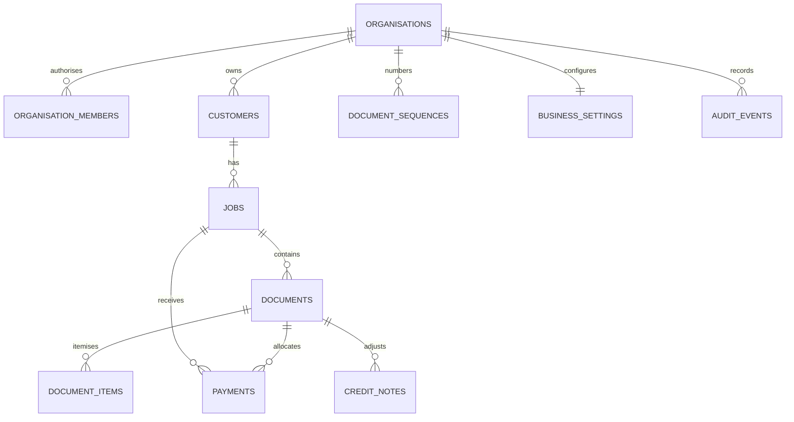

# Database schema

PostgreSQL with RLS, authorised functions and immutable issue snapshots. All tenancy keys are server-chosen from approved membership, never accepted as a client-selected organisation ID.

`documents` shares the safe save/issue/calculation machinery across quote, booking and invoice kinds. `quotations`, `bookings`, `invoices`, `quote_items` and `invoice_items` are security-invoker views over those tables. This deliberately avoids three divergent financial implementations. These views retain base-table RLS.

Customers/jobs have UUID primary keys, separate public-facing numbers, JSON descriptive fields, timestamps and optimistic revision counters. All customer descriptive fields may be absent. Jobs require a valid parent customer. Composite organisation foreign keys reject cross-workspace references even if an attacker knows a UUID.

Document body contains editable scope, pricing inputs, tax basis, dates, terms and requested deposit. `calculate_document` independently recomputes persisted cents from validated input rows. `document_items` materialises the same authoritative line breakdown. Supplied frontend totals are ignored. Issue records a customer/job/settings snapshot. Issued invoice/booking bodies cannot be edited via any browser grant. Edited quotations do not rewrite invoice snapshots.

One deposit per job; one final receipt per invoice. An unallocated job deposit is attached once when an invoice is issued. Future invoices cannot reuse it. Payment amounts are positive, actual dates cannot be in the future, cumulative receipts/credits cannot exceed invoice total. Overpayments are explicitly rejected for review; refunds are outside this version. Credit notes have separate sequential IDs, GST components and reasons. Original invoice amount remains intact while `credit_cents` records total adjustments. Paid/partial/overdue display is derived from receipts, credits, issue state and due date; no user-editable paid toggle exists.

Critical financial operations use an organisation-scoped transaction advisory lock plus row locking. Number increments use atomic upserts. Optimistic revisions reject stale drafts and settings. Unique constraints prevent duplicate document numbers, deposit/final rows and active bookings. The local WASM test runs on one connection: simultaneous distributed-client load still needs a real-project acceptance test.

Direct authenticated grants are read-only with membership RLS. Authorised writes go through explicit SECURITY DEFINER functions with empty search paths and internal membership checks. Helpers for numbering, audit and calculation are not executable by browser roles. No self-provisioning or role-management RPC exists.
